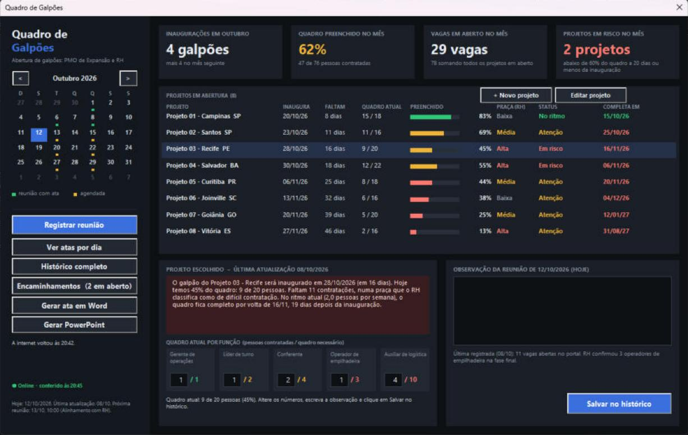
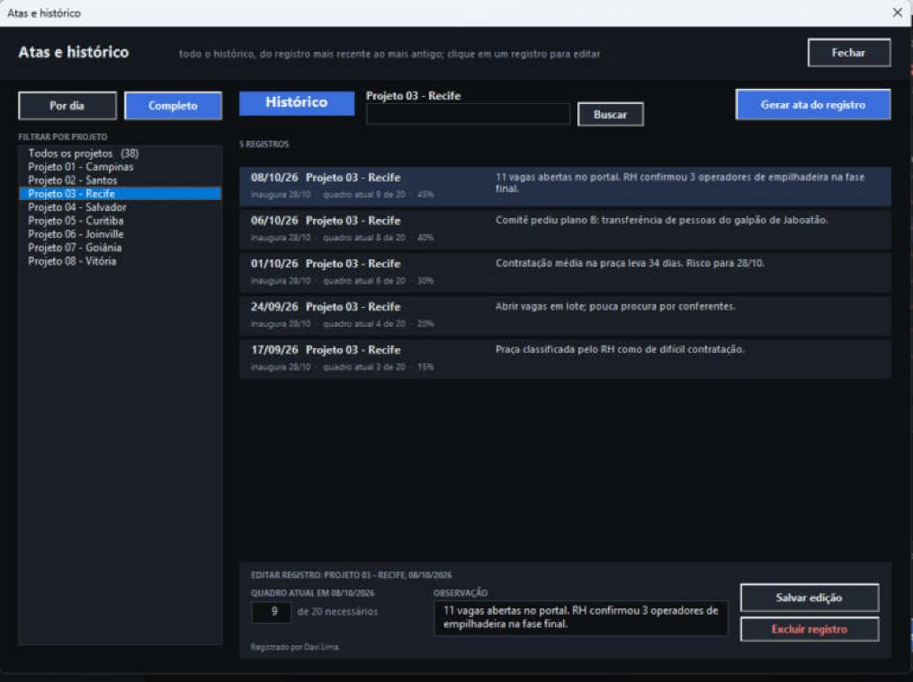
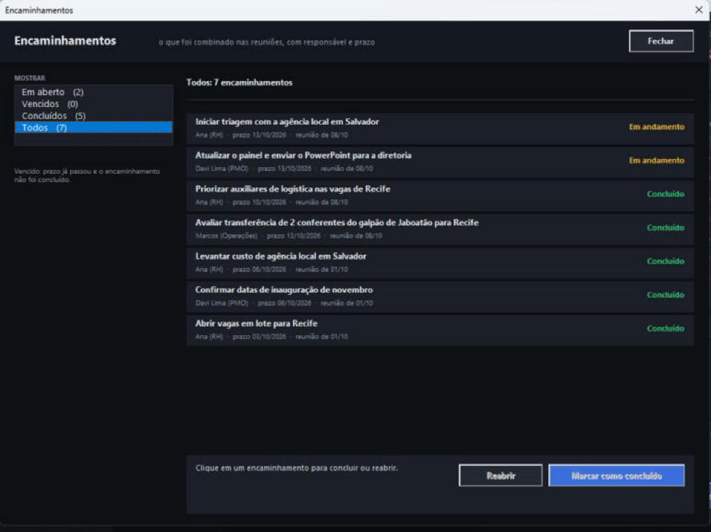
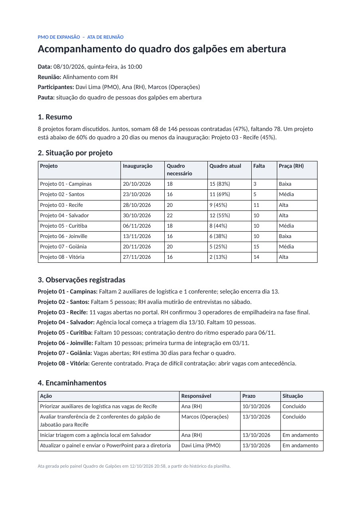
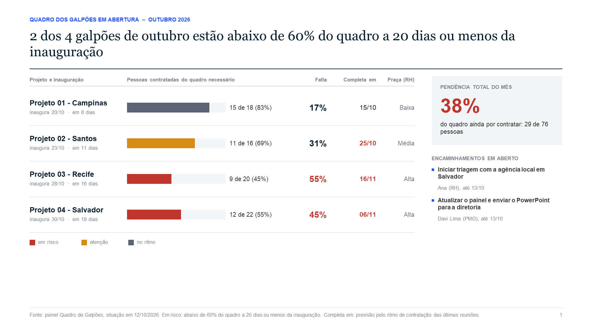
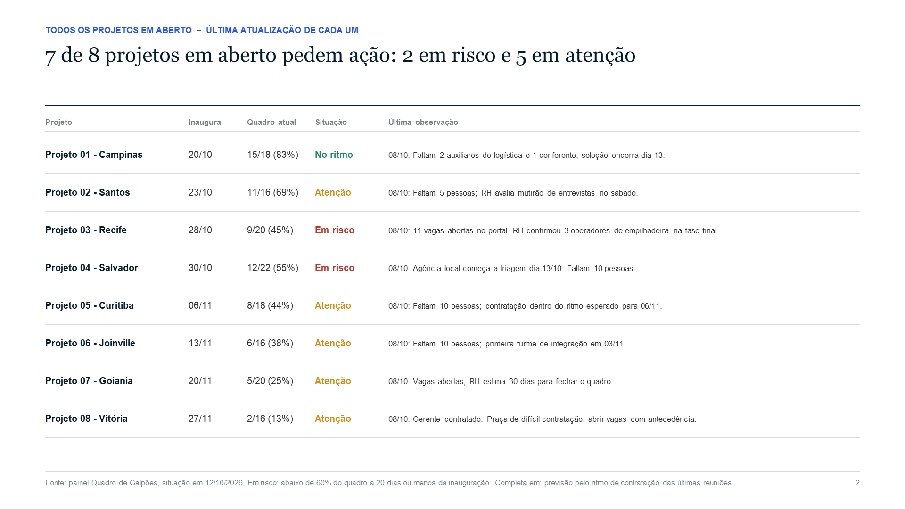
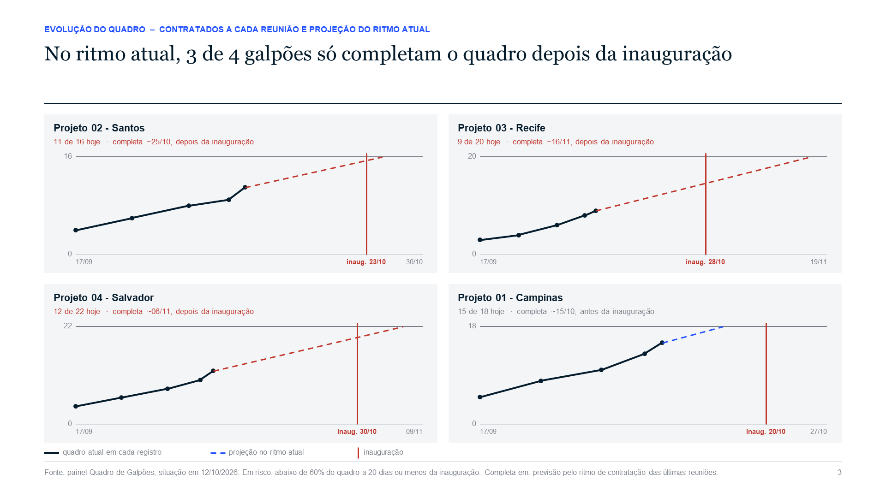

# Quadro de Galpões

Um painel em Excel para acompanhar a contratação das equipes dos galpões em abertura. Ele foi pensado para a reunião semanal entre PMO e RH, que precisa responder: **o galpão vai abrir com a equipe completa?** Quando a resposta é não, o painel avisa com antecedência.

Cada reunião vira um registro: quantas pessoas já foram contratadas, em cada função, e o que foi combinado. O painel mostra a situação mais recente de cada projeto e guarda o histórico. A partir dele, gera a ata em Word e a apresentação do mês em PowerPoint. É VBA puro: sem suplementos e sem banco de dados externo.

> Este repositório é uma vitrine: mostra o que o projeto faz e como foi construído. O código-fonte não é público. Todos os dados são fictícios.

## O que o painel mostra

Com a base fictícia (8 galpões, inaugurações em outubro e novembro de 2026, vista em 12/10/2026):

| Pergunta | Resposta do painel |
|---|---|
| Quantos galpões inauguram em outubro? | 4, mais 4 em novembro |
| Quanto do quadro de outubro já foi contratado? | 62% (47 de 76 pessoas) |
| Quais projetos estão em risco? | Recife e Salvador: abaixo de 60% do quadro a 20 dias ou menos da inauguração |
| No ritmo atual, quando Recife completa o quadro? | Por volta de 16/11, 19 dias depois da inauguração |
| O que foi combinado e ainda está em aberto? | 2 encaminhamentos, com responsável e prazo |

Para cada projeto, o painel monta a frase que vai para a reunião: *"O galpão do Projeto 03 - Recife será inaugurado em 28/10/2026 (em 16 dias). Hoje temos 45% do quadro: 9 de 20 pessoas. Faltam 11 contratações, numa praça que o RH classifica como de difícil contratação. No ritmo atual (2,0 pessoas por semana), o quadro fica completo por volta de 16/11, 19 dias depois da inauguração."*

## Funcionalidades

- **Calendário de reuniões**: verde para reuniões com ata, âmbar para as agendadas. Clicar em um dia escolhe a data do registro.
- **Situação de cada projeto**: quadro atual e necessário, praça (dificuldade de contratar, segundo o RH), status e a data prevista para o quadro ficar completo.
- **Previsão pelo ritmo de contratação**: uma reta ajustada aos últimos registros de cada projeto, estendida até o quadro necessário. Um projeto que pelo percentual parece "no ritmo", mas só completa o quadro depois da inauguração, passa para "atenção".
- **Registro da reunião**: quadro atual por função e observação. O painel mostra sempre a última atualização; as anteriores ficam no histórico.
- **Atas por dia e histórico completo**: filtro por projeto, busca na observação, edição e exclusão. Cada registro guarda quem registrou, quem editou e quando.
- **Encaminhamentos**: em aberto, vencidos e concluídos, com responsável e prazo.
- **Cadastro de projetos**: data de inauguração, praça e quadro necessário por função.
- **Ata em Word e apresentação em PowerPoint**, gerados com um clique.
- **Segurança dos dados**: salva a planilha a cada gravação, faz uma cópia por dia, não grava nada se a planilha abrir como somente leitura e avisa quando a internet cai ou volta.

### Histórico completo

### Encaminhamentos

### Ata em Word

A ata sai do histórico do dia escolhido: participantes, resumo, situação por projeto, observações e encaminhamentos. Ela é salva automaticamente na pasta Atas.

### Apresentação em PowerPoint

Os slides seguem o padrão de consultoria: o título é a conclusão, escrita a partir dos números, e cada página trata de um assunto. Os gráficos são desenhados com formas, sem imagens coladas.

## Como foi construído

| Parte | Papel |
|---|---|
| Camada de dados | Única parte que lê e grava células. Acha as colunas pelo nome do cabeçalho, então a ordem pode mudar. Faz backup, salva e bloqueia gravação em modo somente leitura. |
| Regras | Situação dos projetos, previsão por mínimos quadrados, resumo do mês e textos prontos. Não toca em células. |
| Classes | Projeto (com o quadro por função), registro do histórico, reunião, encaminhamento, calendário e a ligação dos controles aos eventos (`WithEvents`). |
| Formulários | Painel, atas e histórico, encaminhamentos, reunião e projeto. Todos os controles são criados por código. |
| Word e PowerPoint | Ata e slides gerados por ligação tardia, sem referência de biblioteca. |
| Conexão | Confere a internet a cada 15 segundos com a API do Windows, enquanto o painel está aberto. |
| Instalador | Um script que aplica o painel em qualquer planilha com as mesmas abas, ou atualiza o código sem perder os dados. |

## Como foi testado

- **Regras fora do Excel (38 conferências)**: situação de cada projeto, resumo do mês, frase do alerta, leitura de datas, normalização de cabeçalhos e a previsão de quadro completo, conferida contra um cálculo de referência feito em Python.
- **De ponta a ponta no Excel**: instalação pelo script, registro, edição e exclusão no histórico, busca, cadastro de projeto, encaminhamentos, ata em Word e apresentação em PowerPoint.

## Autor

**Davi Lima**, Analista de Planejamento no PMO de Expansão.
[LinkedIn](https://www.linkedin.com/in/davi-lima-362723214/)
